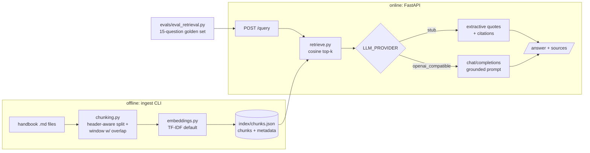

# rag-handbook-qa

A retrieval-augmented Q&A service over my backend interview notes
([java-backend-interview-handbook](https://github.com/BhagyashriT/java-backend-interview-handbook)).
Ask a question, get an answer grounded in the notes with file + section citations.

Built as the AI-lane portfolio project: the same RAG pattern that shows up in
half the "how I got the AI job" stories — ingestion pipeline, retrieval,
grounded generation, and evals I can whiteboard end to end.

## Architecture



## API contract

This shape is frozen — an external eval harness targets it.

```
GET /health
→ {"status": "ok", "index_loaded": true, "chunks": 220,
   "embedder": "tfidf", "llm": "stub"}

POST /query        {"question": "How do you make a POST endpoint idempotent?"}
→ {"answer": "...",
   "sources": [{"file": "backend/api-idempotency.md",
                "section": "API contracts and idempotency > Idempotency key pattern",
                "score": 0.0965}]}
```

`top_k` is optional in the request body (default 4, max 10).
`503` when the index hasn't been built yet; `422` on a blank question.

## Quickstart

```bash
# 1. corpus (the notes live in a separate repo — not vendored here)
git clone --depth 1 https://github.com/BhagyashriT/java-backend-interview-handbook corpus

# 2. deps
python3 -m venv .venv && . .venv/bin/activate
pip install -r requirements.txt

# 3. ingest: 49 files -> 220 chunks
python -m rag_handbook_qa.ingest --corpus corpus --out index/chunks.json

# 4. serve
uvicorn rag_handbook_qa.api:app --port 8000

curl -X POST localhost:8000/query -H 'Content-Type: application/json' \
  -d '{"question": "What are the four caching patterns?"}'
```

## Configuration

| Variable | Default | Purpose |
|---|---|---|
| `INDEX_PATH` | `index/chunks.json` | where ingest writes / the API reads |
| `EMBEDDING` | `tfidf` | `tfidf` or `sentence-transformer` |
| `ST_MODEL` | `sentence-transformers/all-MiniLM-L6-v2` | dense model when using `sentence-transformer` |
| `LLM_PROVIDER` | `stub` | `stub` (extractive, no key) or `openai_compatible` |
| `OPENAI_BASE_URL` | `https://api.openai.com/v1` | any OpenAI-style endpoint (Ollama/LM Studio work) |
| `OPENAI_API_KEY` | — | read from env only; never committed |
| `OPENAI_MODEL` | `gpt-4o-mini` | chat model name |
| `DEFAULT_TOP_K` | `4` | retrieval depth |

## Retrieval evals

`evals/golden.json` holds 15 hand-written questions against the actual notes
(file + section expectations). Run:

```bash
python evals/eval_retrieval.py --index index/chunks.json
```

Measured 2026-10-20 with the default TF-IDF backend, k=5:

| Metric | Result |
|---|---|
| file hit-rate@5 | **15/15 = 1.00** |
| section hit-rate@5 | **14/15 = 0.93** |
| MRR@5 | **0.811** |

## Trade-offs

- **TF-IDF default, dense embeddings opt-in.** TF-IDF needs no model download,
  is deterministic, and runs on any free tier — at the cost of lexical-only
  matching (paraphrases can miss). `EMBEDDING=sentence-transformer` swaps in
  MiniLM when semantic recall matters; the interface is identical.
- **File-based JSON index, no vector DB.** 220 chunks fit in memory; the index
  is human-inspectable and diffable. A vector DB (pgvector/Qdrant) becomes
  worth it past ~100k chunks or for multi-tenant filtering.
- **Embeddings rebuilt at startup, not serialized.** Keeps the index file small
  and avoids pickling sklearn internals; rebuild takes ~2s on this corpus.
- **Header-aware chunking + overlap windowing.** Sections stay semantically
  whole (breadcrumb metadata doubles as the citation), and 1500-char windows
  with 200-char overlap bound the context each chunk carries.
- **Stub LLM by default.** Deterministic, keyless, and honest: it quotes the
  notes instead of generating. The OpenAI-compatible backend adds real
  generation with a "context-only, cite sources, or say you don't know" prompt.

## Limitations

- Retrieval is lexical by default — genuinely paraphrased questions can miss
  (see evals; the dense backend exists for this).
- Stub mode quotes; it does not synthesize or reason across chunks.
- The index is static until you re-run ingest — notes edited after ingest are
  invisible to the API.
- No authentication, no per-tenant isolation; single-process in-memory matrix.
- `score` is a cosine similarity, not a calibrated confidence.

## Deploy on Render (free tier)

> Not deployed yet — these are the exact steps; deployment is one click in the dashboard.

1. **New → Web Service**, connect this repo.
2. **Build command:**
   ```
   pip install -r requirements.txt && git clone --depth 1 https://github.com/BhagyashriT/java-backend-interview-handbook corpus && python -m rag_handbook_qa.ingest --corpus corpus --out index/chunks.json
   ```
3. **Start command:**
   ```
   uvicorn rag_handbook_qa.api:app --host 0.0.0.0 --port $PORT
   ```
4. **Environment:** `LLM_PROVIDER=stub` (keyless). To use real generation, add
   `LLM_PROVIDER=openai_compatible`, `OPENAI_BASE_URL`, `OPENAI_API_KEY`, `OPENAI_MODEL`.
5. Set the **health check path** to `/health`. Note: free-tier instances sleep
   when idle — first request after sleep takes ~30s while the index rebuilds.

## Tests

```bash
python -m pytest -q   # 13 tests: chunking, retrieval, API contract
```

CI runs the suite on every push to `main`.
